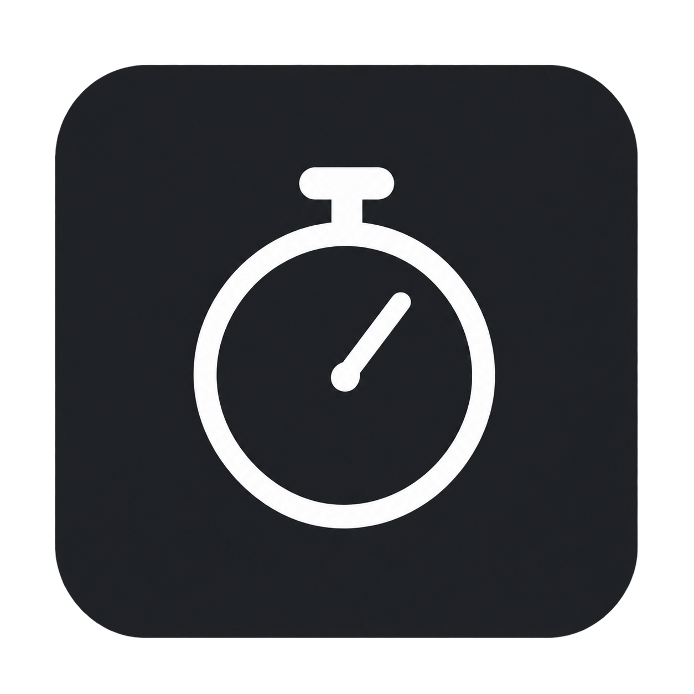

# 悬浮计时 · Floating Study Timer



给每天按分钟安排学习的人做的本地 macOS 小工具。只做一件事：在其他窗口上方显示时间，记录每一项学习的实际时长。

## 打开

首次使用先从源码构建：

```sh
git clone https://github.com/Doz1324/floating-study-timer.git
cd floating-study-timer
bash scripts/build.sh
open dist/悬浮计时.app
```

构建后可双击 `dist/悬浮计时.app`，或双击本目录的 `启动悬浮计时.command`。仓库不包含预编译应用。

这是独立的原生 Mac 应用，不需要浏览器、账号、联网或上架 App Store。最低 macOS 13；构建脚本按本机架构编译，目前已在 Apple 芯片 Mac 上验证。可以把 `.app` 拖入“应用程序”后使用。

## 日常操作

| 操作 | 用法 |
| --- | --- |
| 开始 / 暂停 / 继续 | 点击左侧播放 / 暂停按钮；暂停时间不累计 |
| 空格键 | 点一下悬浮钟上的时间，再按空格开始、暂停或继续。点回其他应用后，空格由该应用接收 |
| 结束一项 | 点击方块；保留结果并存入本地记录，再点播放开始下一项 |
| 复位 | 点击回转箭头；误点后可在右键菜单里“撤销复位”，恢复为暂停 |
| 清醒 | 点闪电，再用触控板或鼠标碰跳动的小秒表。迷你模式悬停后可见闪电 |
| 迷你 / 展开 | 点击双箭头，或双击空白处；迷你模式平时只有时间，悬停出现按钮 |
| 移动 | 拖动时间或空白处 |
| 缩放 | 鼠标移上去后，拖动右下角的两条斜线 |
| 锁定 | 右键 → 锁定位置和大小，防止误拖；按钮仍可操作 |
| 切换计时方式 | 右键 → 正计时 / 倒计时；切换保留实际累计时长 |
| 设计划分钟数 | 右键 → 计划时长，输入 1–1440 的整数；确认后进入倒计时 |
| 复制或查看记录 | 右键 → 复制实际时长 / 最近记录；点某条记录即可复制 |
| 退出 | 右键，或菜单栏的秒表图标 → 退出悬浮计时 |

倒计时到零后用暖橙色显示 `+00:01` 等超时时间，继续记录学习，不弹窗、不自动结束。无论显示正计时还是倒计时，保存的都是实际学习时长。

清醒模式每局 30 秒。滑过小秒表算一次命中，它会立刻换位置。每累计 6 次命中升一档，五档停留时间依次为 1.5、1.1、0.8、0.6、0.45 秒。第 24 次命中后保持最高档，玩到倒计时结束。悬浮钟显示当前档位、总命中次数和剩余秒数。

这 30 秒从学习时长中扣除。时间到后，原来运行的学习计时保持暂停，点播放即可继续。中途主动点「回到学习」会提前退出并恢复原先正在运行的任务。

最近记录菜单显示最后 10 条，全部记录仍保存在本机；“复制全部记录”可以粘贴到你原有的待办或表格里。不加入任务管理、统计图表、番茄钟、账号和云同步。

## 窗口与恢复

- 原生 `NSPanel`，跨桌面和全屏空间显示，点击计时按钮不要求把学习应用切到后台。
- 位置和大小只在手动移动、缩放、切换迷你模式时变化；显示器断开导致窗口离屏时，会移回可见区域。
- 关闭再打开会保留时长和窗口位置，计时保持暂停，避免把关闭期间算作学习。
- Mac 进入系统睡眠时暂停；唤醒后手动继续。切换应用、桌面或正常全屏不暂停。
- 运行中每 5 秒保存一次检查点，开始、暂停、结束等操作立即保存。异常终止可能损失最后不足 5 秒；正常退出会保存并暂停。
- 本地记录位于 `~/Library/Application Support/FloatingStudyTimer/state.json`。不上传任何内容。

“最小化”在这里指迷你悬浮模式，不是缩进 Dock。覆盖普通应用及原生全屏应用是目标；锁屏、系统安全界面、其他更高层悬浮窗口、部分独占全屏游戏，以及系统桌面切换动画不属于绝对覆盖保证。多显示器下只有一个计时窗，不会在每块屏幕复制。

## 自己重新构建

需要 Apple Command Line Tools；未安装时可运行 `xcode-select --install`。不需要完整 Xcode：

```sh
bash scripts/build.sh
bash scripts/test.sh
```

运行 `bash scripts/test-wake-ui.sh` 可另外验证清醒模式。它会短暂打开独立的全屏测试窗口，用临时学习记录检查追逐、超时和返回后的计时。

构建脚本按当前 Mac 架构编译，并做本地临时签名。这个构建供本机使用；若以后发给别人，可再做 Developer ID 签名和公证，也可以选择上架。不要为了运行应用去关闭 Gatekeeper。

应用图标为已确认的黑白极简秒表样式，原图位于 `Resources/Icon/AppIcon.png`。构建时会自动生成 16–1024 像素的图标尺寸并打包成 `Resources/AppIcon.icns`。图标生成说明见 `Resources/Icon/设计说明.md`。

## 实现依据

- [Apple：可加入其他应用全屏空间的窗口](https://developer.apple.com/documentation/appkit/nswindow/collectionbehavior-swift.struct/canjoinallapplications)
- [Apple：NSPanel](https://developer.apple.com/documentation/appkit/nspanel)
- [Apple：Mac App Store 之外的分发](https://developer.apple.com/macos/distribution/)

具体测试与尚未覆盖的场景见 `docs/验证记录.md`。

## 许可证

本项目采用 [MIT License](LICENSE)。图标由 AI 辅助生成，生成说明与提示词见 [图标设计说明](Resources/Icon/设计说明.md)。
